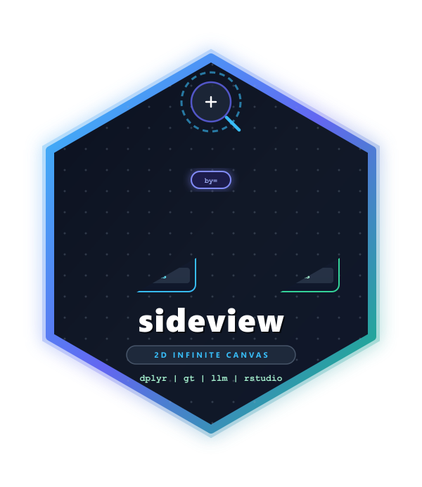
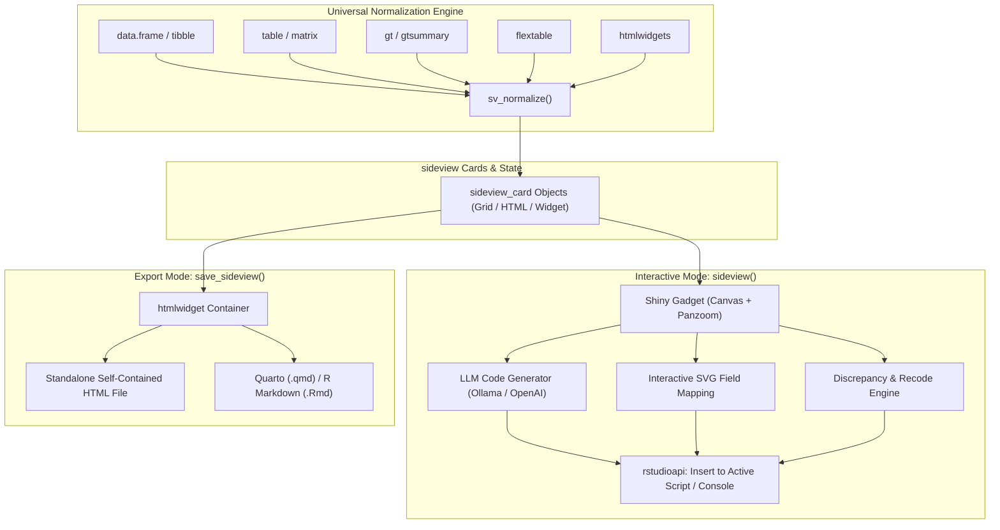

# sideview 

<!-- badges: start -->
[](https://github.com/sideview/sideview)
[](https://opensource.org/licenses/MIT)
[](https://lifecycle.r-lib.org/articles/stages.html#experimental)
[](https://cran.r-project.org/)
<!-- badges: end -->

> **Multi-Table 2D Infinite Canvas for Interactive Data Exploration, Visual Field Mapping, and LLM-Assisted Tidyverse Code Generation**

---

## Overview

When analyzing complex data workflows, data scientists frequently work with multiple related tables simultaneously: clinical demographics, longitudinal vitals, lab panels, crosswalk dictionaries, and summary reports. 

Existing tools force analysts into **siloed, tabbed interfaces** where only one table is visible at a time. Switching back and forth between tabs breaks cognitive flow, obscures structural discrepancies, and makes mental reconciliation of column mappings error-prone.

**`sideview`** replaces tabbed viewers with a hardware-accelerated **2D infinite canvas**. You can place any number of heterogeneous tabular datasets side-by-side, zoom and pan freely across the workspace, visually connect columns across tables with interactive SVG splines, automatically detect categorical discrepancies, and generate idiomatic `tidyverse` code that pastes directly into your active RStudio script editor.

```r
library(sideview)

# Launch side-by-side multi-table canvas in RStudio Viewer or Gadget Window
sideview(patients, visits, lab_results, gt_summary)
```

---

## Why `sideview`? Comparison with `dataviewR`

| Feature | `dataviewR` | `sideview` |
| :--- | :---: | :---: |
| **Workspace Layout** | Single-table tabbed view (one table at a time) | **Infinite 2D canvas** (unlimited tables side-by-side) |
| **Navigation** | Basic paging | **Smooth mouse-wheel zoom (25%–250%) & canvas pan** |
| **Minimap Overview** | ❌ None | ✅ **Interactive radar minimap with click-to-jump** |
| **Table Alignment** | ❌ None | ✅ **Magnetic snap-to-edge docking** |
| **Synchronized Scrolling** | ❌ None | ✅ **Locked synchronous vertical row scrolling** |
| **Multi-Format Ingestion** | `data.frame` only | ✅ **`data.frame`, `tibble`, `table`, `matrix`, `gt`, `flextable`, `htmlwidgets`** |
| **Visual Column Mapping** | ❌ None | ✅ **Click-to-connect interactive SVG splines** |
| **Discrepancy Detection** | ❌ None | ✅ **Exact & fuzzy string matching with distance scoring** |
| **Categorical Recoding** | ❌ None | ✅ **Automatic `dplyr::case_match` & `forcats::fct_recode`** |
| **Tidyverse Code Generation**| ❌ None | ✅ **`left_join`, `inner_join`, `mutate`, `rename`, `filter`** |
| **AI / LLM Assistance** | ❌ None | ✅ **Local Ollama & Cloud OpenAI with privacy-safe schema** |
| **RStudio Script Insertion** | ❌ None | ✅ **Direct 1-click cursor paste via `rstudioapi`** |
| **Standalone HTML Export** | ❌ None | ✅ **Self-contained `htmlwidget` (`save_sideview()`)** |
| **Quarto & Rmd Support** | ❌ None | ✅ **Embeddable via `sideview_widget()`** |

---

## Architecture Overview

`sideview` is built on a **Dual-Hybrid Architecture**:



1. **Interactive Shiny Gadget & RStudio Addin (`sideview()`)**:
   - Bi-directional reactive communication between the JavaScript Panzoom canvas and the R session.
   - Live column mapping, discrepancy detection, and AI prompting.
   - Code delivery into the user's active editor buffer via `rstudioapi::insertText()`.

2. **Standalone HTML Widget Export (`save_sideview()`)**:
   - Self-contained, zero-dependency HTML bundles embeddable in reports, Quarto presentations, or shared offline with stakeholders.

---

## Key Features

### 1. Infinite 2D Panzoom Canvas
- **Focal-point Zoom**: Smooth scaling from 25% to 250% centered on your mouse cursor.
- **Canvas Panning**: Middle-click or canvas drag to traverse large multi-table layouts.
- **Minimap Radar**: Real-time canvas radar showing card positions with click-to-jump navigation.
- **Snap-to-Edge Alignment**: Drag cards into alignment with magnetic guides for side-by-side row inspection.
- **Synchronized Row Scrolling**: Lock vertical scrolling between any pair of tables to visually inspect matched records.

### 2. Universal Multi-Format Normalization
`sideview` seamlessly accepts heterogeneous R tabular structures in a single call:
- **`data.frame` & `tibble`**: Virtualized interactive grid cards.
- **`base::table` & `matrix`**: Automatically converted to 2D frequency/matrix grid cards.
- **`gt` & `gtsummary`**: Rendered with raw HTML styling, while preserving the underlying data frame (`gt_tbl$`_data`) for full code generation.
- **`flextable`**: Rendered with full styling, retaining the underlying dataset for joins and mutations.
- **`htmlwidgets`** (`DT`, `reactable`, etc.): Visual embedded cards for side-by-side comparison.

### 3. Click-to-Connect Field Mapping & Codegen
- Click a column in Table A and a column in Table B to draw an interactive SVG bezier spline between them.
- Open the **Action Drawer** to immediately generate idiomatic R code:
  - **Relational Joins**: `left_join`, `inner_join`, `full_join`, `anti_join`.
  - **Computed Mutations**: `mutate(new_col = expression)`.
  - **Column Renames**: `rename(new_name = old_name)` with automatic syntactic backtick escaping.
  - **Filters & Selects**: Synthesize reproducible filtering and column selection pipelines.

### 4. Categorical Discrepancy Detection & Recoding
- Cross-table discrepancy analysis (`sv_detect_discrepancies()`):
  - Identifies exact matches, unique categories in Table A, and unique categories in Table B.
  - Uses vectorized Levenshtein distance calculations to spot fuzzy typos (e.g., `"M"` vs `"Male"`, `"Compl."` vs `"Completed"`).
- Emits reproducible recoding pipelines using `dplyr::case_match` or `forcats::fct_recode`:
  ```r
  patients <- patients %>%
    dplyr::mutate(status = dplyr::case_match(
      status_raw,
      c("Compl.", "completed") ~ "Completed",
      "InProg" ~ "In Progress",
      .default = status_raw
    ))
  ```

### 5. Dual LLM AI Code Assistant
- **Local Ollama Integration**: Zero data leakage — connects to your local Ollama instance (`http://localhost:11434`) running models such as `llama3.2`, `codellama`, or `deepseek-coder`.
- **Cloud OpenAI-Compatible Providers**: Works with OpenAI (`gpt-4o`, `gpt-4o-mini`), OpenRouter, Groq, LM Studio, or vLLM.
- **Privacy-Safe Schema Context**: Prompts automatically synthesize column names, data types, and non-sensitive distributions *without* leaking confidential individual records.

### 6. Zero-Click RStudio Integration
- **Insert into Active Script**: Inserts generated tidyverse code right at the cursor position in RStudio (`rstudioapi::insertText`).
- **Send to Console**: Sends and optionally executes code immediately in the R console (`rstudioapi::sendToConsole`).
- **Graceful Fallbacks**: When running outside of RStudio (e.g., terminal R, Jupyter, or VS Code), safely falls back to standard console output or clipboard with informative notices.

---

## Installation

Install the development version of `sideview` from GitHub:

```r
# install.packages("remotes")
remotes::install_github("sideview/sideview")
```

### Dependencies
- **Core**: `shiny`, `htmltools`, `htmlwidgets`, `dplyr`, `httr2`, `jsonlite`, `rstudioapi`
- **Suggested**: `gt`, `flextable`, `testthat`, `knitr`, `rmarkdown`

---

## Quick Start Examples

### 1. Launch Interactive Gadget with Heterogeneous Tables

```r
library(sideview)
library(dplyr)

# Standard data frame
patients <- data.frame(
  patient_id = c("P01", "P02", "P03", "P04"),
  age = c(45, 52, 38, 61),
  gender_raw = c("Male", "Female", "M", "Fem"),
  stringsAsFactors = FALSE
)

# Tibble
visits <- tibble(
  subject_id = c("P01", "P02", "P03", "P05"),
  systolic_bp = c(120, 140, 115, 130),
  visit_date = as.Date(c("2024-01-10", "2024-01-15", "2024-02-01", "2024-02-10"))
)

# Base R contingency table
dx_freq <- table(c("Hypertension", "Diabetes", "Hypertension", "Asthma"))

# Launch Sideview canvas
sideview(patients, visits, diagnoses = dx_freq)
```

### 2. Including `gt` and `flextable` Objects

```r
library(gt)
library(flextable)

gt_summary <- gt(patients[, c("patient_id", "age")])
flex_visits <- flextable(as.data.frame(visits))

# Both stylized HTML tables and raw data grids are accessible on the canvas
sideview(patients, visits, gt_summary, flex_visits)
```

### 3. Export to Standalone HTML Widget

Share interactive canvas boards as self-contained HTML files with zero external server dependencies:

```r
# Save to an HTML file
save_sideview(
  sideview_widget(patients, visits, diagnoses = dx_freq),
  file = "study_overview.html",
  selfcontained = TRUE,
  title = "Clinical Study Multi-Table Overview"
)
```

### 4. Embedding in Quarto (`.qmd`) or R Markdown (`.Rmd`)

````markdown
---
title: "Clinical Data Harmonization"
format: html
---

```{r}
library(sideview)
sideview_widget(patients, visits, width = "100%", height = "650px")
```
````

### 5. Using in Custom Shiny Applications

```r
library(shiny)
library(sideview)

ui <- fluidPage(
  titlePanel("Study Review Dashboard"),
  sideviewOutput("my_canvas", width = "100%", height = "750px")
)

server <- function(input, output, session) {
  output$my_canvas <- renderSideview({
    sideview_widget(patients, visits)
  })
}

shinyApp(ui, server)
```

---

## LLM Configuration Guide

`sideview` includes an AI prompt bar for natural-language data manipulation (e.g. *"Join patients and visits, recode gender, and calculate average BP for patients over 50"*).

### Option A: Local Ollama (Recommended — 100% Private, Zero Data Leakage)

1. Install and start [Ollama](https://ollama.ai/):
   ```bash
   ollama run llama3.2
   ```
2. By default, `sideview` connects to `http://localhost:11434` with `llama3.2`.
3. To customize default Ollama options in R:
   ```r
   options(
     sideview.llm_backend = "ollama",
     sideview.llm_model = "llama3.2",
     sideview.llm_endpoint = "http://localhost:11434"
   )
   ```

### Option B: Cloud OpenAI-Compatible Providers

Set your API key as an environment variable or via options:

```r
# In your ~/.Renviron file or R session:
Sys.setenv(OPENAI_API_KEY = "sk-...")

options(
  sideview.llm_backend = "openai",
  sideview.llm_model = "gpt-4o-mini",
  sideview.llm_endpoint = "https://api.openai.com/v1"
)
```

Compatible with:
- **OpenAI**: `https://api.openai.com/v1`
- **OpenRouter**: `https://openrouter.ai/api/v1`
- **Groq**: `https://api.groq.com/openai/v1`
- **LM Studio**: `http://localhost:1234/v1`
- **vLLM**: `http://localhost:8000/v1`

---

## Keyboard Shortcuts & Canvas Controls

| Action | Control / Shortcut | Description |
| :--- | :--- | :--- |
| **Zoom In / Out** | `Mouse Wheel` | Smooth scaling centered at cursor position (25% to 250%) |
| **Pan Canvas** | `Click + Drag` or `Space + Drag` | Pan across the infinite canvas |
| **Reset View** | `Double Click Canvas` or `Home` | Centers and resets zoom to 100% |
| **Jump to Table** | `Click Card in Minimap` | Instantly moves viewport to the selected card |
| **Move Table Card** | `Drag Card Header` | Reposition card anywhere on canvas |
| **Dock / Snap** | `Drag near card edge` | Snaps cards together with magnetic guidelines |
| **Rename Column** | `Double-click column header` | Inline edit; generates `dplyr::rename()` |
| **Filter Column** | `Click Filter Icon (🔍)` | Opens text, numeric range, or checklist filter |
| **Color Highlight** | `Click Cell / Row + Palette Swatch` | Annotate cells or rows with custom highlighter colors |
| **Synchronized Scroll** | `Click Link Icon (🔗)` on card header | Locks vertical scroll between adjacent tables |
| **Connect Columns** | `Click Column A` then `Click Column B` | Draws SVG bezier spline and opens Codegen Drawer |
| **Submit AI Prompt** | `Ctrl + Enter` / `Cmd + Enter` | Sends prompt to configured LLM |
| **Insert Code to Script** | `Click "Insert to Script"` | Pastes generated R code at cursor via `rstudioapi` |
| **Send to Console** | `Click "Run in Console"` | Sends generated code directly to active R console |

---

## Complete Programmatic API Reference

| Function | Module | Description |
| :--- | :--- | :--- |
| `sideview(...)` | Interactive Gadget | Launch Shiny Gadget or RStudio Addin on arbitrary tables |
| `sideview_addin()` | RStudio Addin | Addin entry point registered in RStudio Addins menu |
| `sideview_widget(...)` | Widget | Create an exportable `htmlwidget` instance |
| `save_sideview(widget, file)` | Widget Export | Export canvas to standalone self-contained HTML file |
| `sideviewOutput(id, ...)` | Shiny Integration | Shiny UI widget container |
| `renderSideview(expr, ...)` | Shiny Integration | Shiny server rendering function |
| `sv_normalize(x, name, id)` | Normalization | S3 generic converting tables to standardized cards |
| `sv_find_tables(env)` | Discovery | Detect all tabular objects in an environment |
| `sv_code_join(...)` | Code Generation | Emits `dplyr::left_join`, `inner_join`, `full_join`, `anti_join` |
| `sv_code_rename(...)` | Code Generation | Emits `dplyr::rename()` with non-syntactic backtick escaping |
| `sv_code_mutate(...)` | Code Generation | Emits `dplyr::mutate()` expressions |
| `sv_code_filter(...)` | Code Generation | Emits `dplyr::filter()` expressions |
| `sv_code_select(...)` | Code Generation | Emits `dplyr::select()` column selections |
| `sv_detect_discrepancies(...)`| Discrepancies | Vectorized exact & fuzzy Levenshtein discrepancy detection |
| `sv_code_recode(...)` | Discrepancies | Emits `dplyr::case_match()` or `forcats::fct_recode()` |
| `sv_build_schema_context(...)` | LLM Engine | Privacy-safe metadata synthesis for LLM prompt |
| `sv_build_prompt(...)` | LLM Engine | Constructs system instructions and user prompt |
| `sv_call_llm(...)` | LLM Engine | Dispatches request to Ollama or OpenAI-compatible backend |
| `sv_extract_code(...)` | LLM Engine | Extracts clean R code from markdown fences |
| `sv_is_rstudio_available()` | RStudio Bridge | Checks if RStudio API is available |
| `sv_insert_code(code)` | RStudio Bridge | Inserts text into active document editor |
| `sv_send_to_console(code)` | RStudio Bridge | Sends code to R console for execution |

---

## Development & Testing

Run unit and integration tests using `testthat`:

```bash
Rscript -e "testthat::test_dir('tests/testthat')"
```

Regenerate package documentation with `roxygen2`:

```bash
Rscript -e "roxygen2::roxygenise()"
```

---

## License

This package is licensed under the [MIT License](LICENSE).

---

## Medical & Diagnostic Disclaimer

`sideview` is an exploratory data analysis, visualization, and code generation tool intended for research, education, and general data science workflows. It is **not certified as medical device software** and is **not intended for clinical diagnosis or patient treatment decisions**.
