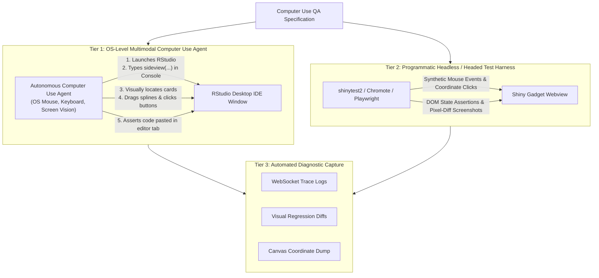

# sideview: v0.2.0 Pillar 5 — Computer Use & Automated RStudio GUI Verification Specification

**Date**: 2026-10-21  
**Status**: Target Design Specification  
**Milestone**: `v0.2.0`  
**Package**: `sideview`  
**Pillar**: 5 of 5  

---

## 1. Executive Summary & Purpose

`sideview` is heavily visual and interactive: its core value lies in the physical ergonomics of mouse-wheel zooming, panning, dragging table cards, drawing SVG splines between column ports, popping open header filters, and interacting with RStudio's native editor tabs and console via `rstudioapi`.

While standard R unit tests (`testthat`) verify R functions and Shiny event handlers, they cannot verify whether:
* The 2D canvas pan and zoom feel smooth without jitter or visual clipping in RStudio's embedded QtWebEngine/Chromium Viewer.
* Dragging an SVG connector spline from Port A to Port B accurately snaps to the target column under different display DPI scalings.
* Clicking `Insert Script` correctly positions text at the cursor in the active `.R` editor tab.
* The Action Drawer buttons (`Run & Exit`, `Run in R`, `Clear`) properly release the R session without deadlock.

This specification establishes an **Automated Computer Use & GUI Verification Harness** enabling AI Computer Use agents and browser automation frameworks (`shinytest2`, Playwright, Chromote) to autonomously operate RStudio Desktop and verify the package UI exactly as a human data analyst would.

---

## 2. Multi-Tiered GUI Verification Architecture



---

## 3. Tier 1: Multimodal Computer Use Agent Protocol

Vision-enabled Computer Use agents (equipped with OS-level screen capture, mouse movement, click, and keyboard typing tools) execute autonomous validation against RStudio Desktop following structured recipes.

### Standard Test Recipe: End-to-End Workflow Validation

```
Scenario: Full Multi-Table Visual Mapping & RStudio Script Insertion
Given an active RStudio Desktop instance on Windows / macOS / Linux
When the agent executes the following steps:
  1. Open or focus RStudio Desktop.
  2. In the RStudio Console pane, type:
       library(sideview)
       patients <- data.frame(patient_id = c("P1", "P2", "P3"), age = c(45, 62, 38))
       visits   <- data.frame(patient_id = c("P1", "P2", "P4"), date = c("2026-01-01", "2026-02-15", "2026-03-10"))
       sideview(patients, visits)
     and press Enter.
  3. Visual Inspection 1:
     - Verify the RStudio Viewer pane (or pop-up gadget window) renders with title 'Sideview Canvas'.
     - Confirm two table cards ('patients' and 'visits') are visible on the 2D canvas.
  4. Canvas Interaction:
     - Move cursor to the canvas background, hold Middle Mouse (or Left Drag) to pan the canvas 100px left.
     - Scroll mouse wheel down to zoom in to ~125%.
     - Move cursor to the header of the 'visits' card and drag it 150px to the right to test magnetic docking.
  5. Spline Mapping:
     - Locate the right-side port of column 'patient_id' in card 'patients'.
     - Click and drag an SVG connector spline across to the left-side port of 'patient_id' in card 'visits'.
     - Release mouse.
     - Verify an SVG cubic bezier spline appears connecting both columns.
  6. Action Drawer Verification:
     - Inspect the Action Drawer at the bottom right.
     - Verify code textarea contains:
         patients %>% dplyr::left_join(visits, by = c("patient_id" = "patient_id"))
  7. Editor Insertion Verification:
     - Click an open, empty R script tab in the RStudio Editor.
     - In the Sideview Action Drawer, click 'Insert Script'.
     - Visual Assertion: Confirm that the tidyverse left_join pipeline text is immediately inserted at the cursor position in the script editor.
  8. Gadget Exit Verification:
     - In Sideview, click 'Run & Exit'.
     - Confirm the gadget window closes and control returns cleanly to the R console with zero errors.
```

---

## 4. Tier 2: Programmatic Headless & Headed Browser Harness (`shinytest2`)

For continuous integration (CI) workflows where an interactive OS desktop is unavailable, a headless browser test harness is implemented under `tests/testthat/test-computer-use-gui.R` using `shinytest2` and `chromote`.

### Coordinate-Based Interaction Test Harness

```r
# tests/testthat/test-computer-use-gui.R
test_that("Computer Use GUI: Card dragging and spline drawing produce valid DOM state", {
  skip_on_cran()
  skip_if_not_installed("shinytest2")
  
  app <- shinytest2::AppDriver$new(
    app_dir = system.file("shiny", package = "sideview"),
    name = "sideview-computer-use-test",
    height = 900,
    width = 1400,
    view = FALSE # Headless Chrome
  )
  
  # 1. Wait for canvas initialization
  app$wait_for_js("window.sideviewInitialized === true", timeout = 10000)
  
  # 2. Assert initial card positions
  card_1_pos <- app$get_js("document.querySelector('#card_000001').getBoundingClientRect()")
  expect_true(card_1_pos$width > 200)
  expect_true(card_1_pos$height > 150)
  
  # 3. Simulate dragging 'visits' card by 120px
  app$run_js("
    const header = document.querySelector('#card_000002 .sideview-card-header');
    const evtDown = new MouseEvent('mousedown', { clientX: 450, clientY: 100, bubbles: true });
    const evtMove = new MouseEvent('mousemove', { clientX: 570, clientY: 100, bubbles: true });
    const evtUp   = new MouseEvent('mouseup',   { clientX: 570, clientY: 100, bubbles: true });
    header.dispatchEvent(evtDown);
    document.dispatchEvent(evtMove);
    document.dispatchEvent(evtUp);
  ")
  
  # 4. Simulate clicking port on patients$patient_id and visits$patient_id
  app$run_js("
    const portA = document.querySelector('#card_000001 [data-col=\"patient_id\"] .port-out');
    const portB = document.querySelector('#card_000002 [data-col=\"patient_id\"] .port-in');
    portA.click();
    portB.click();
  ")
  
  # 5. Assert SVG spline element rendered
  spline_count <- app$get_js("document.querySelectorAll('.sideview-spline').length")
  expect_equal(spline_count, 1)
  
  # 6. Capture screenshot for visual regression
  app$expect_screenshot()
  
  app$stop()
})
```

---

## 5. Visual Regression & Diagnostic Failure Artifacts

When an automated Computer Use test fails or detects an anomaly:
1. **Full-Resolution Screenshot**: Saved as `artifacts/gui_failure_<timestamp>.png`.
2. **WebSocket Trace Log**: Captures every message exchanged between `sideview.js` and `app_server.R`.
3. **Canvas Topographical Dump**: Serializes the bounding client rectangles of every card, header, port, and spline curve to `artifacts/canvas_failure_dump.json`.
4. **Browser Console Output**: Captures all JavaScript exceptions, warnings, and network status codes.

```
+-------------------------------------------------------------+
| AUTOMATED GUI DIAGNOSTIC REPORT                             |
| Test: Scenario 5 (Spline Mapping & Script Injection)       |
| Status: FAILED                                              |
| Failure Point: Step 5 (Spline Connection)                   |
| Error: Port element '.port-in' did not register click event |
|                                                             |
| Captured Artifacts:                                         |
|  - Screenshot: artifacts/gui_failure_20261021_063512.png    |
|  - Canvas Dump: artifacts/canvas_failure_dump.json          |
|  - WS Log: 14 messages recorded (last: 'column_clicked')     |
+-------------------------------------------------------------+
```

---

## 6. Execution Command Reference

* **Run Programmatic Browser QA**:
  ```powershell
  Rscript -e "testthat::test_file('tests/testthat/test-computer-use-gui.R')"
  ```
* **Run Interactive Headed Computer Use Visual Session**:
  ```powershell
  $env:SIDEVIEW_HEADED_QA="TRUE"; Rscript -e "testthat::test_file('tests/testthat/test-computer-use-gui.R')"
  ```
* **Multimodal Computer Use Agent Invocation**:
  Equip the AI agent with desktop vision and invoke:
  > *"Launch RStudio Desktop, run sideview(mtcars, iris), verify that dragging the header moves the card smoothly, connect mpg to Sepal.Length, and confirm the code appears in the active editor tab."*
