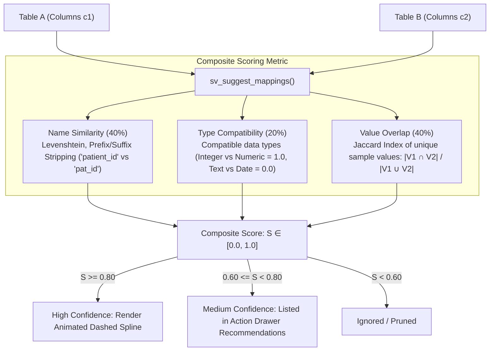

# sideview: v0.2.0 Pillar 4 — Intelligent Copilot & Auto-Mapping Specification

**Date**: 2026-10-21  
**Status**: Target Design Specification  
**Milestone**: `v0.2.0`  
**Package**: `sideview`  
**Pillar**: 4 of 5  

---

## 1. Executive Summary & Goals

In v0.1.0, table relationships must be established manually by the user clicking ports, and AI assistance is limited to a single-shot prompt box. When working with unfamiliar or legacy databases containing dozens of tables, analysts often struggle to identify which columns link together.

**Pillar 4 Objectives**:
1. **Proactive Foreign Key Detection**: Implement `sv_suggest_mappings()` to analyze column names, types, and sample value distributions across loaded tables.
2. **Suggested Spline Visuals**: Render high-confidence joins as dashed animated connector splines that users can accept with a single click.
3. **Automated Discrepancy Resolution**: Automatically detect common data hygiene issues (casing differences, trailing whitespace, typos) and synthesize instant 1-click `case_match` cleaning rules.
4. **Conversational Multi-Turn Copilot Drawer**: Transition from a single prompt box to a full conversation assistant that maintains conversational context and iteratively edits active pipelines.

---

## 2. Heuristic Foreign Key Detection Engine (`sv_suggest_mappings`)

### Scoring Model
The recommendation engine evaluates every column pair $(c_1 \in T_1, c_2 \in T_2)$ and calculates a composite confidence score $S \in [0, 1]$:

$$S = 0.40 \cdot \text{NameSim}(c_1, c_2) + 0.20 \cdot \text{TypeCompat}(c_1, c_2) + 0.40 \cdot \text{Jaccard}(V_1, V_2)$$



### Algorithm Implementation (`R/copilot.R`)

```r
#' Suggest Candidate Column Mappings Across Loaded Tables
#'
#' @param cards List of `sideview_card` objects.
#' @param min_confidence Minimum confidence threshold (default 0.70).
#' @return A data.frame of candidate joins with columns:
#'   `from_table`, `from_col`, `to_table`, `to_col`, `confidence`, `reason`.
#' @export
sv_suggest_mappings <- function(cards, min_confidence = 0.70) {
  # Compares pairwise across all tables with tabular data
  candidates <- list()
  
  for (i in seq_along(cards)) {
    for (j in seq_along(cards)) {
      if (i >= j) next
      c1 <- cards[[i]]
      c2 <- cards[[j]]
      if (is.null(c1$data) || is.null(c2$data)) next
      
      # Evaluate pairs of columns
      for (col1 in colnames(c1$data)) {
        for (col2 in colnames(c2$data)) {
          v1 <- c1$data[[col1]]
          v2 <- c2$data[[col2]]
          
          # 1. Name Similarity
          n1 <- tolower(gsub("[^a-zA-Z0-9]", "", col1))
          n2 <- tolower(gsub("[^a-zA-Z0-9]", "", col2))
          dist <- utils::adist(n1, n2)[1, 1]
          name_sim <- max(0, 1 - (dist / max(nchar(n1), nchar(n2), 1)))
          
          # Bonus for exact or standard ID naming
          if (n1 == n2) name_sim <- 1.0
          if (grepl("id$", n1) && grepl("id$", n2) && name_sim > 0.5) name_sim <- min(1.0, name_sim + 0.2)
          
          # 2. Type Compatibility
          t1 <- class(v1)[1]
          t2 <- class(v2)[1]
          type_compat <- if (t1 == t2) {
            1.0
          } else if (all(c(t1, t2) %in% c("integer", "numeric"))) {
            0.9
          } else {
            0.0
          }
          
          # 3. Jaccard Value Overlap
          u1 <- unique(as.character(stats::na.omit(v1)))
          u2 <- unique(as.character(stats::na.omit(v2)))
          u_inter <- length(intersect(u1, u2))
          u_union <- length(union(u1, u2))
          jaccard <- if (u_union > 0) u_inter / u_union else 0
          
          score <- (0.40 * name_sim) + (0.20 * type_compat) + (0.40 * jaccard)
          
          if (score >= min_confidence) {
            candidates[[length(candidates) + 1]] <- list(
              from_table = c1$name,
              from_col = col1,
              to_table = c2$name,
              to_col = col2,
              confidence = round(score, 3),
              reason = sprintf("Name similarity %.0f%%, value overlap %.0f%%", name_sim * 100, jaccard * 100)
            )
          }
        }
      }
    }
  }
  
  do.call(rbind, lapply(candidates, as.data.frame))
}
```

---

## 3. UI Suggested Spline Rendering & 1-Click Acceptance

* When `sv_suggest_mappings()` returns candidates with score $\ge 0.80$:
  * `sideview.js` renders an SVG spline with class `.sideview-spline-suggested`:
    ```css
    .sideview-spline-suggested {
      stroke: #3b82f6;
      stroke-dasharray: 6, 6;
      stroke-width: 2px;
      opacity: 0.65;
      animation: dashMove 1.5s linear infinite;
      cursor: pointer;
    }
    @keyframes dashMove {
      to { stroke-dashoffset: -12; }
    }
    ```
  * Hovering displays a floating tooltip: `Suggested Join: patients$patient_id ➔ visits$patient_id (Confidence: 94%)`.
  * **Click-to-Accept**: Clicking converts the spline into a solid active connector and dispatches `column_mapped` to immediately update the Action Drawer code.

---

## 4. Automated Discrepancy Cleaning Engine

When discrepancies are calculated via `sv_detect_discrepancies()`, `sideview` v0.2.0 automatically analyzes unmatched values for common data entry flaws:

| Flaw Category | Detected Pattern | Automated Fix Proposal |
| :--- | :--- | :--- |
| **Casing Variations** | `"male"` vs `"Male"` | Suggests title casing or case folding |
| **Surrounding Whitespace** | `" In Progress "` vs `"In Progress"` | Generates `stringr::str_trim()` |
| **Typographical Variations** | Levenshtein distance $\le 2$ (`"Compl."` vs `"Complete"`) | Generates `dplyr::case_match()` crosswalk rule |

A prominent button **"Apply Suggested Cleanups (N rules)"** inserts the generated recode block directly into the pipeline ahead of the join.

---

## 5. Conversational Multi-Turn Copilot Drawer

The single-shot text field in v0.1.0 is upgraded to a conversational thread:

```
+-------------------------------------------------------------+
| Action Drawer > Copilot Chat                                |
|                                                             |
| User: Filter visits to patients older than 65 and summarize |
|       average length of stay by department.                 |
|                                                             |
| Copilot: Updated pipeline with age filtering and            |
|          group_by(department):                              |
|                                                             |
|   ```r                                                      |
|   patients %>%                                              |
|     dplyr::filter(age > 65) %>%                             |
|     dplyr::inner_join(visits, by = "patient_id") %>%        |
|     dplyr::group_by(department) %>%                         |
|     dplyr::summarise(avg_los = mean(los, na.rm = TRUE))     |
|   ```                                                       |
|                                                             |
| User: Now sort by avg_los descending.                       |
| Copilot: Added arrange(desc(avg_los)) to the pipeline.      |
|                                                             |
| [ Type a prompt or adjustment...                 ] [ Send ] |
+-------------------------------------------------------------+
```

### Context Management Contract
* Stores conversation history in `session$userData$chat_history`.
* Automatically includes the **current pipeline code** and **table schema summaries** in every conversational prompt, ensuring iterative changes preserve previous user refinements.
