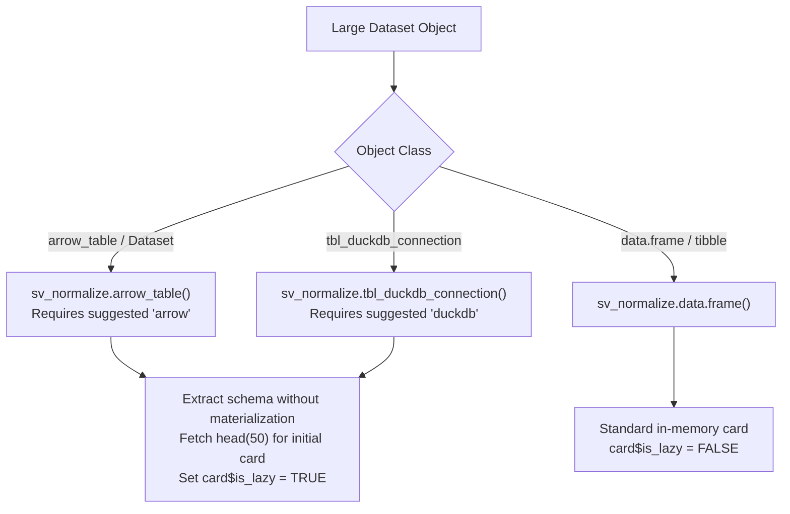
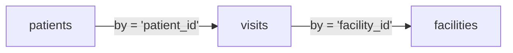

# sideview: v0.2.0 Pillar 1 — Scalability & CRAN Readiness Specification

**Date**: 2026-10-21  
**Status**: Target Design Specification  
**Milestone**: `v0.2.0`  
**Package**: `sideview`  
**Pillar**: 1 of 5  

---

## 1. Executive Summary & Goals

In v0.1.0, `sideview` renders table cards by writing DOM `<tr>` rows directly into the card body. While performant for tables with up to 1,000 rows, datasets containing 50,000 to 500,000+ rows cause browser tab freezing, excessive memory consumption, and DOM thrashing. Furthermore, v0.1.0 column mapping only links one column pair between two tables at a time.

**Pillar 1 Objectives**:
1. **100k+ Row Scalability**: Render 100,000+ row datasets at 60 FPS using client-side **DOM Virtual Scrolling**.
2. **Zero-Copy Big Data Ingestion**: Add lazy schema ingestion for Apache Arrow (`arrow::Table`, `arrow::Dataset`) and DuckDB (`duckdb_connection`, `tbl_duckdb_connection`).
3. **CRAN Dependency Architecture**: Keep `arrow`, `duckdb`, and large packages strictly in `Suggests:` to ensure zero mandatory compilation overhead on CRAN build machines.
4. **Multi-Key Join Architecture**: Allow analysts to link multiple column pairs between the same two tables (e.g. `patient_id` AND `visit_date`), generating composite `by = c(...)` joins.
5. **CRAN Readiness Gate**: Pass `R CMD check --as-cran` with 0 errors, 0 warnings, and 0 notes.

---

## 2. Lazy Data Ingestion: Arrow & DuckDB

### Soft Dependency Pattern
To prevent CRAN installation bottlenecks on systems without pre-compiled Arrow C++ libraries:
* `arrow` and `duckdb` are declared under `Suggests:` in `DESCRIPTION`.
* Ingestion methods check `requireNamespace()` dynamically with informative error messages.



### S3 Method Signatures (`R/normalize.R`)

```r
#' @export
sv_normalize.arrow_table <- function(x, name = NULL, id = NULL, ...) {
  if (!requireNamespace("arrow", quietly = TRUE)) {
    stop("Package 'arrow' is required to normalize Arrow tables. Install with install.packages('arrow').", call. = FALSE)
  }
  if (is.null(name)) name <- "Arrow_Table"
  
  # Extract metadata zero-copy
  schema <- x$schema
  col_names <- names(schema)
  col_types <- vapply(schema$fields, function(f) f$type$ToString(), character(1))
  nr <- nrow(x)
  nc <- ncol(x)
  
  # Fetch preview head without full materialization
  preview_df <- as.data.frame(head(x, 50L))
  
  new_sideview_card(
    id = id,
    name = name,
    type = "grid",
    data = preview_df,
    dims = c(nr, nc),
    col_types = col_types,
    is_lazy = TRUE,
    lazy_source = x
  )
}

#' @export
sv_normalize.tbl_duckdb_connection <- function(x, name = NULL, id = NULL, ...) {
  if (!requireNamespace("duckdb", quietly = TRUE)) {
    stop("Package 'duckdb' is required to normalize DuckDB tables.", call. = FALSE)
  }
  if (is.null(name)) name <- "DuckDB_Table"
  
  # Query schema via DBI / dplyr
  col_names <- colnames(x)
  preview_df <- as.data.frame(utils::head(x, 50L))
  col_types <- vapply(preview_df, function(c) class(c)[1], character(1))
  
  # Get total count via dplyr::count()
  nr <- as.integer(dplyr::pull(dplyr::count(x)))
  nc <- length(col_names)
  
  new_sideview_card(
    id = id,
    name = name,
    type = "grid",
    data = preview_df,
    dims = c(nr, nc),
    col_types = col_types,
    is_lazy = TRUE,
    lazy_source = x
  )
}
```

---

## 3. Client-Side DOM Virtualization Viewport

### The Problem in v0.1.0
In v0.1.0, rendering 10,000 rows generates 10,000 `<tr>` and 100,000 `<td>` elements in the browser DOM. The browser memory usage spikes past 1 GB and scrolling stutters.

### The Virtual Scrolling Architecture (`inst/www/sideview.js`)
Instead of populating all rows, the card table container maintains a fixed viewport height (e.g., 380px) and a calculated total virtual height based on `total_rows * row_height` (e.g. 28px).

```
+-------------------------------------------------------+
| Card Viewport (380px visible window)                  |
|                                                       |
|  [ Top Spacer Div: height = start_idx * 28px ]        |
|  ---------------------------------------------------  |
|  Visible Rows (~25-35 DOM <tr> elements only)         |
|  Row 1042:  | PT-1042 | 2026-03-12 | Active | 120/80 | |
|  Row 1043:  | PT-1043 | 2026-03-12 | Active | 118/78 | |
|  Row 1044:  | PT-1044 | 2026-03-13 | Inact  | 142/90 | |
|  ---------------------------------------------------  |
|  [ Bottom Spacer Div: height = (total - end) * 28px ] |
|                                                       |
+-------------------------------------------------------+
```

### JavaScript Virtual Table Implementation

```javascript
class VirtualTable {
  constructor(containerEl, totalRows, rowHeight = 28, bufferCount = 10) {
    this.container = containerEl;
    this.totalRows = totalRows;
    this.rowHeight = rowHeight;
    this.buffer = bufferCount;
    this.viewportHeight = this.container.clientHeight || 380;
    this.visibleCount = Math.ceil(this.viewportHeight / this.rowHeight);
    
    this.tbody = this.container.querySelector('tbody');
    this.topSpacer = document.createElement('tr');
    this.bottomSpacer = document.createElement('tr');
    
    this.container.addEventListener('scroll', () => this.onScroll());
    this.render();
  }

  onScroll() {
    const scrollTop = this.container.scrollTop;
    const startIndex = Math.max(0, Math.floor(scrollTop / this.rowHeight) - this.buffer);
    const endIndex = Math.min(this.totalRows, startIndex + this.visibleCount + 2 * this.buffer);
    
    this.updateWindow(startIndex, endIndex);
  }

  updateWindow(startIndex, endIndex) {
    // Only ~30 rows in DOM at any instant
    const topHeight = startIndex * this.rowHeight;
    const bottomHeight = (this.totalRows - endIndex) * this.rowHeight;
    
    this.topSpacer.style.height = `${topHeight}px`;
    this.bottomSpacer.style.height = `${bottomHeight}px`;
    
    // Dispatch lazy fetch to Shiny server if rows are not cached locally
    if (this.isLazy && !this.hasRowsCached(startIndex, endIndex)) {
      Shiny.setInputValue('request_table_chunk', {
        card_id: this.cardId,
        start: startIndex,
        limit: endIndex - startIndex
      });
    }
  }
}
```

---

## 4. Multi-Key Relational Joins & Pipeline Chaining

### Current Limitation (v0.1.0)
Drawing a second spline between two tables replaces the existing join rather than augmenting it.

### Multi-Key Join Architecture (v0.2.0)
* When a user connects column `col_b1` to `col_b2` after already connecting `col_a1` to `col_a2` on the same pair of tables:
  * The canvas retains **both** splines visually.
  * In `sideview.js`, connections are grouped by table pair:
    ```javascript
    activeJoins = {
      "patients->visits": {
        df1: "patients",
        df2: "visits",
        join_type: "left",
        keys: [
          { from: "patient_id", to: "patient_id" },
          { from: "site_code",  to: "hospital_id" }
        ]
      }
    };
    ```
  * Dispatches `column_mapped` with vector keys:
    ```javascript
    {
      from_table: "patients",
      to_table: "visits",
      from_cols: ["patient_id", "site_code"],
      to_cols: ["patient_id", "hospital_id"],
      join_type: "left"
    }
    ```
  * `sv_code_join()` emits composite tidyverse syntax:
    ```r
    patients %>%
      dplyr::left_join(visits, by = c("patient_id" = "patient_id", "site_code" = "hospital_id"))
    ```

### Visual Multi-Step DAG Pipeline Chaining
When Table A links to Table B, and Table B links to Table C:

Emits chained pipeline:
```r
patients %>%
  dplyr::left_join(visits, by = c("patient_id" = "patient_id")) %>%
  dplyr::left_join(facilities, by = c("facility_id" = "facility_id"))
```

---

## 5. CRAN Readiness Verification Checklist

To pass CRAN submission without human editorial rejection:

1. **Zero External Compiled Code**: All R code is clean C-free R, relying on pure S3 and standard `htmltools` / `htmlwidgets`.
2. **Offline-Safe Vignettes**: Any vignettes utilizing `sideview()` must use `eval = FALSE` or mock widgets so CRAN build servers running without an active browser or X11 display do not fail.
3. **Asset Size Budget**: All bundled JS/CSS in `inst/www/` (`panzoom.min.js`, `sideview.css`, `sideview.js`) must remain under 100 KB total gzip size.
4. **Clean R CMD check**:
   ```powershell
   R CMD build .
   R CMD check --as-cran sideview_0.2.0.tar.gz
   ```
   Must yield `Status: 0 ERRORs, 0 WARNINGs, 0 NOTEs`.
