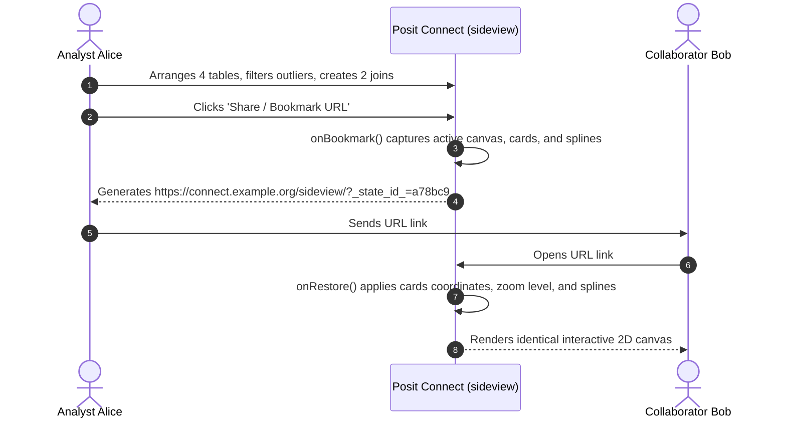

# sideview: v0.2.0 Pillar 3 — Canvas State Persistence & Cloud Sharing Specification

**Date**: 2026-10-21  
**Status**: Target Design Specification  
**Milestone**: `v0.2.0`  
**Package**: `sideview`  
**Pillar**: 3 of 5  

---

## 1. Executive Summary & Goals

In v0.1.0, when a user closes a `sideview()` session, all visual workspace customizations (card coordinates, zoom/pan levels, active spline connectors, applied filters, and column sort orders) are lost. Analysts working on complex exploratory pipelines across dozens of tables need to save their workspace layout and resume later or share it with team members.

**Pillar 3 Objectives**:
1. **Workspace State Serialization**: Define a formal `sideview_state` JSON and RDS schema capturing the complete canvas topology.
2. **State Management APIs**: Export `sv_save_state()` and `sv_load_state()` for persistent file storage.
3. **Shiny Bookmarking for Cloud Deployments**: Integrate Shiny URL bookmarking (`enableBookmarking("url")`) for seamless sharing on Posit Connect and Shiny Server.
4. **Multi-Session Isolation**: Guarantee zero cross-user state leakage in multi-tenant environments.

---

## 2. The `sideview_state` Schema Specification

A serialized canvas workspace is represented by an S3 object of class `c("sideview_state", "list")`:

```json
{
  "version": "0.2.0",
  "generated_at": "2026-10-21T06:30:00Z",
  "canvas": {
    "zoom": 1.25,
    "pan_x": -180.5,
    "pan_y": 64.0
  },
  "cards": [
    {
      "id": "card_000001",
      "name": "patients",
      "x": 60,
      "y": 80,
      "width": 380,
      "height": 450,
      "minimized": false,
      "sorts": [
        { "column": "patient_id", "direction": "asc" }
      ],
      "filters": [
        { "column": "status", "operator": "==", "value": "ACTIVE" }
      ]
    },
    {
      "id": "card_000002",
      "name": "visits",
      "x": 520,
      "y": 80,
      "width": 420,
      "height": 450,
      "minimized": false,
      "sorts": [],
      "filters": []
    }
  ],
  "connections": [
    {
      "id": "spline_001",
      "from_table": "patients",
      "from_col": "patient_id",
      "to_table": "visits",
      "to_col": "patient_id",
      "join_type": "left"
    }
  ],
  "pipeline": {
    "code": "patients %>%\n  dplyr::filter(status == 'ACTIVE') %>%\n  dplyr::left_join(visits, by = c('patient_id' = 'patient_id'))",
    "active_tab": "join"
  }
}
```

---

## 3. R Persistence APIs: `sv_save_state` & `sv_load_state`

### 3.1 `sv_save_state` (`R/state.R`)

```r
#' Save Sideview Canvas State to Disk
#'
#' Serializes the active or provided canvas layout, card coordinates,
#' connections, and code pipeline to a `.json` or `.rds` file.
#'
#' @param state A `sideview_state` object or active gadget session.
#' @param file Path to target file (e.g. `"workspace.sideview.json"` or `"workspace.rds"`).
#' @param format Serialization format: `"json"` or `"rds"`. Inferred from extension if NULL.
#' @return The file path invisibly.
#' @export
sv_save_state <- function(state, file, format = NULL) {
  if (is.null(format)) {
    format <- if (grepl("\\.json$", file, ignore.case = TRUE)) "json" else "rds"
  }
  
  if (format == "json") {
    json_str <- jsonlite::toJSON(unclass(state), auto_unbox = TRUE, pretty = TRUE)
    writeLines(json_str, con = file)
  } else {
    saveRDS(state, file = file)
  }
  
  invisible(file)
}
```

### 3.2 `sv_load_state` (`R/state.R`)

```r
#' Load Sideview Canvas State from Disk
#'
#' Deserializes a canvas state and launches an interactive `sideview()` session
#' or returns the validated state object.
#'
#' @param file Path to the `.json` or `.rds` file.
#' @param tables Named list of tabular datasets to bind with the restored layout.
#' @param launch Logical; if TRUE, immediately launches `sideview()` with the restored state.
#' @return A `sideview_state` object or running gadget.
#' @export
sv_load_state <- function(file, tables = NULL, launch = FALSE) {
  if (!file.exists(file)) {
    stop(sprintf("File '%s' not found.", file), call. = FALSE)
  }
  
  state <- if (grepl("\\.json$", file, ignore.case = TRUE)) {
    jsonlite::fromJSON(file, simplifyVector = FALSE)
  } else {
    readRDS(file)
  }
  
  class(state) <- c("sideview_state", "list")
  
  if (launch) {
    if (is.null(tables)) {
      tables <- sv_find_tables(parent.frame())
    }
    sideview(tables = tables, state = state)
  } else {
    state
  }
}
```

---

## 4. Shiny Server & Posit Connect Cloud Integration

### URL Bookmarking (`enableBookmarking("url")`)
When deployed on Posit Connect or Shiny Server, users can bookmark their session to share an exact canvas state via a persistent URL link:



### Server Implementation Hooks (`R/app_server.R`)

```r
# Inside sideview_server_impl:
shiny::onBookmark(function(state) {
  state$values$canvas_state <- session$userData$latest_canvas_state
})

shiny::onRestore(function(state) {
  restored_state <- state$values$canvas_state
  if (!is.null(restored_state)) {
    session$sendCustomMessage("sideview_restore_state", restored_state)
  }
})
```

### Multi-Session Isolation Contract
To guarantee enterprise security on multi-tenant servers:
* All card counters, canvas coordinate trackers, and temporary code buffers are strictly bound to `session$userData`.
* No shared package-level mutable state or global variables are ever accessed during runtime.
