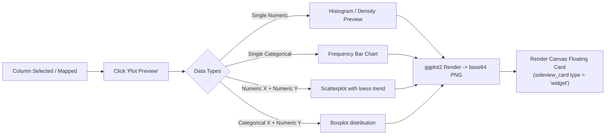

# sideview: v0.2.0 Pillar 2 — Advanced Visual Wrangling & Profiling Specification

**Date**: 2026-10-21  
**Status**: Target Design Specification  
**Milestone**: `v0.2.0`  
**Package**: `sideview`  
**Pillar**: 2 of 5  

---

## 1. Executive Summary & Goals

Data analysts frequently need to inspect data distributions and reshape tables (pivoting and grouping) before joining them. In v0.1.0, `sideview` provides column sorting, filtering, renaming, and joins, but lacks built-in visual data transformation (pivoting/aggregating) and visual column distribution profiling.

**Pillar 2 Objectives**:
1. **Visual Table Reshaping**: Interactive UI modals generating `tidyr::pivot_longer()` and `tidyr::pivot_wider()` pipelines.
2. **Visual Grouping & Summarization**: A visual builder for `dplyr::group_by()` and `dplyr::summarise()`.
3. **Header Column Profiling**: Embedded inline SVG distribution sparklines (mini-histograms) for numeric columns, frequency breakdowns for categorical columns, and color-coded missingness (`NA`) badges.
4. **Quick Plot Preview Cards**: Instant visual charting (`ggplot2`) directly on the 2D canvas.

---

## 2. Visual Reshaping Engine: Pivoting (`tidyr`)

### 2.1 `pivot_longer` Visual Builder
A "Reshape (Long)" button on the table card header opens a configuration modal:
* **Source Columns**: Multi-select checklist of columns to collapse into key-value pairs (or helper selectors like `starts_with("visit_")`).
* **`names_to`**: Target column name for original column headers (default `"metric"`).
* **`values_to`**: Target column name for values (default `"value"`).
* **Interactive Live Preview**: Shows a 5-row preview of the reshaped dataset.

```r
#' Generate tidyverse Code for Reshaping to Long Format
#'
#' @param df_name Name of the data frame.
#' @param cols Character vector of columns to pivot longer.
#' @param names_to Name of the new key column (default "name").
#' @param values_to Name of the new value column (default "value").
#' @param pipe Logical; if TRUE, uses pipe syntax.
#' @return A character string of R code.
#' @export
sv_code_pivot_longer <- function(df_name, cols, names_to = "name", values_to = "value", pipe = FALSE) {
  esc_df <- sv_escape_ident(df_name)
  esc_cols <- sv_escape_ident(cols)
  cols_arg <- if (length(esc_cols) == 1) esc_cols else sprintf("c(%s)", paste(esc_cols, collapse = ", "))
  
  args <- sprintf("cols = %s, names_to = %s, values_to = %s",
                  cols_arg, deparse1(names_to), deparse1(values_to))
  
  if (pipe) {
    sprintf("%s %%>%% tidyr::pivot_longer(%s)", esc_df, args)
  } else {
    sprintf("tidyr::pivot_longer(%s, %s)", esc_df, args)
  }
}
```

### 2.2 `pivot_wider` Visual Builder
* **`names_from`**: Dropdown selecting the column whose distinct values become new column headers.
* **`values_from`**: Dropdown selecting the cell value source.
* **`values_fn`**: Optional aggregation function (`mean`, `sum`, `first`) when duplicate keys exist.

```r
#' @export
sv_code_pivot_wider <- function(df_name, names_from, values_from, values_fn = NULL, pipe = FALSE) {
  esc_df <- sv_escape_ident(df_name)
  esc_names <- sv_escape_ident(names_from)
  esc_vals <- sv_escape_ident(values_from)
  
  args <- sprintf("names_from = %s, values_from = %s", esc_names, esc_vals)
  if (!is.null(values_fn) && nzchar(values_fn)) {
    args <- paste0(args, sprintf(", values_fn = %s", values_fn))
  }
  
  if (pipe) {
    sprintf("%s %%>%% tidyr::pivot_wider(%s)", esc_df, args)
  } else {
    sprintf("tidyr::pivot_wider(%s, %s)", esc_df, args)
  }
}
```

---

## 3. Visual Group & Summarize Builder (`dplyr`)

Analysts can aggregate high-volume records (e.g. multiple visits per patient) into summary statistics prior to joining:

```
+-------------------------------------------------------------+
| Group & Summarize: 'lab_panels'                             |
|                                                             |
| Group By: [x] patient_id   [ ] test_code   [ ] test_date    |
|                                                             |
| Aggregations:                                               |
|  [+] Add Metric:                                            |
|   - total_visits  = dplyr::n()                              |
|   - avg_glucose   = mean(glucose, na.rm = TRUE)             |
|   - max_glucose   = max(glucose, na.rm = TRUE)              |
|                                                             |
| [ Preview Result ]                        [ Insert Pipeline ]|
+-------------------------------------------------------------+
```

### Code Generator (`R/codegen.R`)

```r
#' @export
sv_code_group_summarize <- function(df_name, group_cols, summary_exprs, pipe = FALSE) {
  esc_df <- sv_escape_ident(df_name)
  esc_groups <- sv_escape_ident(group_cols)
  group_str <- paste(esc_groups, collapse = ", ")
  
  expr_pairs <- character(0)
  for (nm in names(summary_exprs)) {
    expr_pairs <- c(expr_pairs, sprintf("%s = %s", sv_escape_ident(nm), summary_exprs[[nm]]))
  }
  summary_str <- paste(expr_pairs, collapse = ",\n    ")
  
  if (pipe) {
    sprintf("%s %%>%%\n  dplyr::group_by(%s) %%>%%\n  dplyr::summarise(\n    %s,\n    .groups = 'drop'\n  )",
            esc_df, group_str, summary_str)
  } else {
    sprintf("dplyr::summarise(\n  dplyr::group_by(%s, %s),\n  %s,\n  .groups = 'drop'\n)",
            esc_df, group_str, summary_str)
  }
}
```

---

## 4. Column Data Profiling & Header Sparklines

To make table cards informative at a glance, each column header in `sideview` v0.2.0 features lightweight visual profiling:

```
+-----------------------------------------------------------------+
| Column Header: systolic_bp                                      |
| [num]   min: 90 | max: 210 | NA: 2.1%                           |
|  _/\_/\_   (Inline SVG mini-histogram, 5 bins)                  |
+-----------------------------------------------------------------+
```

### Profiling Metadata Calculation (`R/app_ui.R` / `render_card_tag`)
* **Numeric Columns**:
  - Computes 5-bin frequencies via `hist(val, breaks = 5, plot = FALSE)$counts`.
  - Normalizes counts to heights between 2px and 14px.
  - Generates a lightweight `<svg>` with 5 `<rect>` bars (total size < 120 bytes of HTML).
* **Categorical / Factor Columns**:
  - Identifies top 3 categories and cardinality count (e.g. `12 levels`).
  - Generates a tiny multi-color stacked bar `<div class="sideview-cat-bar">` representing category proportions.
* **Missingness Badge**:
  - Evaluates `na_pct = sum(is.na(col)) / length(col) * 100`.
  - Color classes:
    - `0%`: Hidden (clean).
    - `0.1% - 10%`: Subtle yellow pill (`3% NA`).
    - `> 10%`: Amber/red alert pill (`24% NA`).

---

## 5. Quick Plot Preview Cards (`ggplot2`)

Users can click a "Plot Preview" icon on any card header or draw a relationship between two columns to inspect a visual scatterplot:



### Architectural Safeguard
* `ggplot2` is an optional dependency in `Suggests:`.
* If `ggplot2` is not installed, the preview card falls back gracefully to base R graphics (`png()` + `graphics::hist()` / `graphics::plot()`), ensuring zero hard runtime dependencies.
