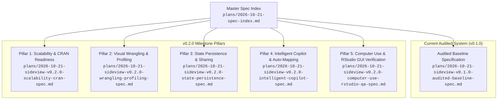

# sideview: Package Specifications Suite (v0.1.0 Audited Baseline & v0.2.0 Architecture)

**Date**: 2026-10-21  
**Status**: Validated Architecture & Specification Suite  
**Package**: `sideview`  
**Repository**: [lauyeehow1986-hub/sideview](https://github.com/lauyeehow1986-hub/sideview)  

---

## 1. Executive Summary & Purpose

`sideview` is an interactive R package and RStudio addin providing a 2D infinite canvas for multi-table exploration, visual field mapping, discrepancy detection, and LLM-assisted tidyverse code generation.

Following a thorough codebase audit of the v0.1.0 implementation (with 705 passing tests across 10 core capabilities) against initial design plans, this specification suite establishes:
1. An **Audited Baseline Specification** documenting the exact runtime architecture, S3 data structures, event dispatch protocols, and code generation contracts implemented in v0.1.0.
2. Five modular **v0.2.0 Milestone Specifications** outlining the next generation architecture for enterprise scalability, visual data wrangling, state persistence, conversational AI copilot, and automated computer use GUI testing.

---

## 2. Specification Suite Navigation



### Document Directory

| Document | Scope & Focus | Target Milestone |
| :--- | :--- | :---: |
| [plans/2026-10-21-sideview-v0.1.0-audited-baseline-spec.md](file:///c:/Users/lauye/Downloads/r_split/plans/2026-10-21-sideview-v0.1.0-audited-baseline-spec.md) | Codebase vs. initial design audit, 10 core capabilities, S3 model, WebSocket protocol, codegen contracts, RStudio integration, 705-test matrix. | **v0.1.0** (Implemented) |
| [plans/2026-10-21-sideview-v0.2.0-scalability-cran-spec.md](file:///c:/Users/lauye/Downloads/r_split/plans/2026-10-21-sideview-v0.2.0-scalability-cran-spec.md) | Arrow / DuckDB lazy schemas (in `Suggests:`), virtualized DOM viewport for 100k+ rows, multi-key joins (`by = c(...)`), chained DAG pipelines, CRAN check compliance. | **v0.2.0** (Next) |
| [plans/2026-10-21-sideview-v0.2.0-wrangling-profiling-spec.md](file:///c:/Users/lauye/Downloads/r_split/plans/2026-10-21-sideview-v0.2.0-wrangling-profiling-spec.md) | Visual pivoting (`pivot_longer`/`pivot_wider`), visual group & summarize builder, inline SVG header sparklines, missingness indicators, and quick `ggplot2` preview cards. | **v0.2.0** (Next) |
| [plans/2026-10-21-sideview-v0.2.0-state-persistence-spec.md](file:///c:/Users/lauye/Downloads/r_split/plans/2026-10-21-sideview-v0.2.0-state-persistence-spec.md) | Canvas state serialization (`.json` & `.rds`), `sv_save_state`/`sv_load_state`, Shiny URL bookmarking (`enableBookmarking("url")`), and multi-session isolation on Posit Connect. | **v0.2.0** (Next) |
| [plans/2026-10-21-sideview-v0.2.0-intelligent-copilot-spec.md](file:///c:/Users/lauye/Downloads/r_split/plans/2026-10-21-sideview-v0.2.0-intelligent-copilot-spec.md) | Automated foreign-key detection (`sv_suggest_mappings`), heuristic string/type/Jaccard scoring, dashed suggestion splines, smart crosswalk rules, and conversational AI drawer. | **v0.2.0** (Next) |
| [plans/2026-10-21-sideview-v0.2.0-computer-use-rstudio-qa-spec.md](file:///c:/Users/lauye/Downloads/r_split/plans/2026-10-21-sideview-v0.2.0-computer-use-rstudio-qa-spec.md) | Multimodal Computer Use agent OS automation recipes, `shinytest2` / Playwright browser harness, coordinate-based spline dragging, RStudio editor & console validation. | **v0.2.0** (Next) |

---

## 3. High-Level System Architecture Evolution

```
+---------------------------------------------------------------------------------------------------+
|                                  SIDEVIEW HIGH-LEVEL ARCHITECTURE                                 |
+---------------------------------------------------------------------------------------------------+
|                                                                                                   |
|  [ INGESTION LAYER ]                                                                              |
|    - Base / Tibble / Matrix / Table                                                               |
|    - Rich Tables: gt_tbl (raw '_data' extract), flextable ('dataset' extract)                    |
|    - HTMLWidgets (sandboxed)                                                                      |
|    - [v0.2.0] Arrow Table / Dataset & DuckDB Connection (Zero-copy Lazy Schema)                  |
|                                                                                                   |
|  [ CORE NORMALIZATION & S3 DATA MODEL ]                                                           |
|    - sv_normalize() -> S3 class 'sideview_card' (monotonic counter ID, zero seed pollution)      |
|    - [v0.2.0] S3 class 'sideview_state' (Workspace serialization & JSON/RDS load/save)           |
|                                                                                                   |
|  [ PRESENTATION & CANVAS RUNTIMES ]                                                               |
|    Mode A: Interactive Gadget (sideview())                                                        |
|      * Panzoom 2D Infinite Canvas (Smooth wheel zoom 25%-250%, pan drag)                         |
|      * Table Cards: Drag & Magnetic Edge Docking                                                  |
|      * Dual Synchronized Scrolling: Lockstep scrollTop + scrollLeft                               |
|      * [v0.2.0] Virtual Scrolling Viewport (rendering 30 rows at 60 FPS for 100k+ rows)           |
|      * [v0.2.0] Header Distribution Sparklines & Missingness Badges                               |
|      * [v0.2.0] Quick ggplot2 Visual Preview Cards                                                |
|    Mode B: Standalone HTMLWidget (save_sideview(), sideview_widget())                             |
|      * Zero-dependency HTML bundle for Quarto (.qmd), R Markdown (.Rmd), and offline sharing      |
|                                                                                                   |
|  [ VISUAL FIELD MAPPING & RELATIONAL DAG ]                                                        |
|    - SVG Cubic Bezier Connector Splines (Click-to-connect column ports)                           |
|    - Interactive Spline Disconnection (Click or right-click curve to sever)                       |
|    - Discrepancy Detection Engine (Vectorized C adist, exact/fuzzy/setdiff breakdown)             |
|    - [v0.2.0] Multi-Key Join Connectors (by = c("key1" = "key1", "key2" = "key2"))               |
|    - [v0.2.0] Multi-Step Chained Pipelines (Table A -> Table B -> Table C)                       |
|    - [v0.2.0] Proactive Join Suggestions & Suggested Splines (sv_suggest_mappings())              |
|                                                                                                   |
|  [ ACTION DRAWER & TIDYVERSE PIPELINE ENGINE ]                                                    |
|    - Header Tri-state Sorting (sv_code_arrange) & Header Popover Filter (sv_code_filter)          |
|    - Categorical Recoding (sv_code_recode: dplyr::case_match, forcats::fct_recode)                |
|    - Join Codegen (sv_code_join: left, inner, anti, full, right, semi)                            |
|    - Robust Backtick Escaping: sv_escape_ident() (spaces, symbols, R keywords)                    |
|    - [v0.2.0] Visual Reshaping (tidyr::pivot_longer / pivot_wider)                               |
|    - [v0.2.0] Group & Summarize Builder (dplyr::group_by + dplyr::summarise)                      |
|                                                                                                   |
|  [ AI ASSISTANCE & COPILOT ]                                                                      |
|    - sv_build_schema_context() (Zero data leakage: summary ranges, factor levels, unique counts)   |
|    - Dual Backends: Local Ollama (gemma4:26b, llama3.2) & Cloud OpenAI-compatible                 |
|    - Robust code extraction: sv_extract_code() regex fence parser                                 |
|    - [v0.2.0] Conversational Multi-Turn Chat Drawer with context retention                       |
|                                                                                                   |
|  [ EXECUTION ROUTING & RSTUDIO INTEGRATION ]                                                      |
|    - 'Insert Script': rstudioapi::insertText() directly at user's cursor                         |
|    - 'Run & Exit': Sends code to console and immediately stops gadget                            |
|    - 'Run in R': Evaluates code directly in .GlobalEnv with live dims feedback                    |
|    - 'Run Console': Queues execution in RStudio console                                           |
|    - 'Clear' / 'Auto-clear': Reset and synchronize state                                          |
|                                                                                                   |
|  [ AUTOMATED QUALITY ASSURANCE & VERIFICATION ]                                                   |
|    - 705 automated unit and integration tests (testthat edition 3)                                |
|    - Web asset syntax validation (node -c sideview.js)                                            |
|    - [v0.2.0] shinytest2 & Chromote headless browser test harness                                 |
|    - [v0.2.0] Multimodal Computer Use Agent Test Suite for OS-level RStudio GUI validation        |
+---------------------------------------------------------------------------------------------------+
```

---

## 4. Key Design Principles

1. **Zero Data Leakage for AI**: Raw patient records or sensitive cell values must never be transmitted to LLMs. Only structural schemas, types, ranges, and cardinality statistics are extracted.
2. **Untouched External Dependencies**: Downstream packages (`arrow`, `duckdb`, `gt`, `flextable`, `ggplot2`) reside in `Suggests:` to ensure zero mandatory compilation overhead and clean CRAN compliance.
3. **Idiomatic Tidyverse Code Generation**: All user visual actions emit human-readable, pipe-friendly (`%>%` or `|>`) R code using official tidyverse semantics (`dplyr`, `tidyr`, `forcats`).
4. **Reproducible Execution**: Every visual manipulation can be exported, inserted into active scripts, evaluated in `.GlobalEnv`, or saved as reproducible state.
5. **Rigorous Verification Gate**: Every capability must have corresponding unit tests in R, asset syntax validation in JS, and automated GUI verification before milestone completion.
